<picture>
  <source media="(prefers-color-scheme: dark)" srcset="assets/dark/header.svg">
  
</picture>

  <a href="https://www.linkedin.com/in/miguel-vera-del-castillo/"><picture><source media="(prefers-color-scheme: dark)" srcset="assets/dark/btn-linkedin.svg"></picture></a>
  <a href="mailto:miguel.vera.delcastillo@gmail.com"><picture><source media="(prefers-color-scheme: dark)" srcset="assets/dark/btn-email.svg"></picture></a>

<picture>
  <source media="(prefers-color-scheme: dark)" srcset="assets/dark/sec-about.svg">
  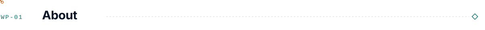
</picture>

I'm Miguel, a final-year **Data Systems Engineering** student at ETSIT-UPM in Madrid and a research assistant at **GPDS**, where I work on drone traffic management for the European U-Space.

My research question is simple to say and hard to answer: when hundreds of drones ask for the same airspace, *who flies first, and is that fair?* I built a flight-authorization simulator and an inverse-inference pipeline that tells a regulator which queue rules produce the fairness profile they want. The first paper is under review, with me as first author.

Outside the lab I build things fast: two hackathon wins, and lately a lot of agent tooling on top of Claude Code.

**Right now**

- 🛰️ Extending the fairness paper into a journal version: neural posterior estimation vs. iterative search
- 🧰 Shipping [`hackathon-kit`](https://github.com/Mveradc/hackathon-kit) v0.5 — jury view and critical path for the Hackathon OS
- 🎓 Final year of my degree, bachelor's thesis on the way

<picture>
  <source media="(prefers-color-scheme: dark)" srcset="assets/dark/sec-work.svg">
  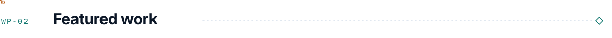
</picture>

<picture>
  <source media="(prefers-color-scheme: dark)" srcset="assets/dark/research.svg">
  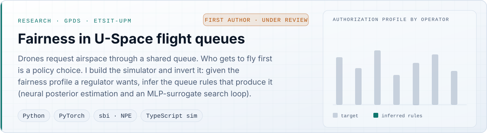
</picture>

  <a href="https://github.com/Mveradc/PipeDream"><picture><source media="(prefers-color-scheme: dark)" srcset="assets/dark/pipedream.svg">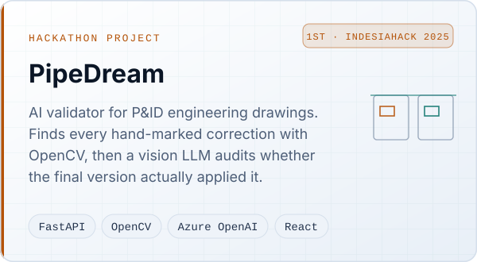</picture></a>
  <a href="https://github.com/Mveradc/hackathon-kit"><picture><source media="(prefers-color-scheme: dark)" srcset="assets/dark/hackathon-kit.svg">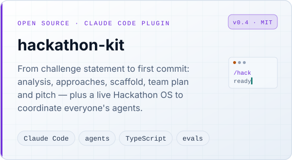</picture></a>

<picture>
  <source media="(prefers-color-scheme: dark)" srcset="assets/dark/sec-log.svg">
  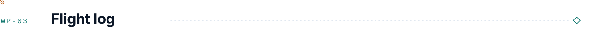
</picture>

<picture>
  <source media="(prefers-color-scheme: dark)" srcset="assets/dark/flight-log.svg">
  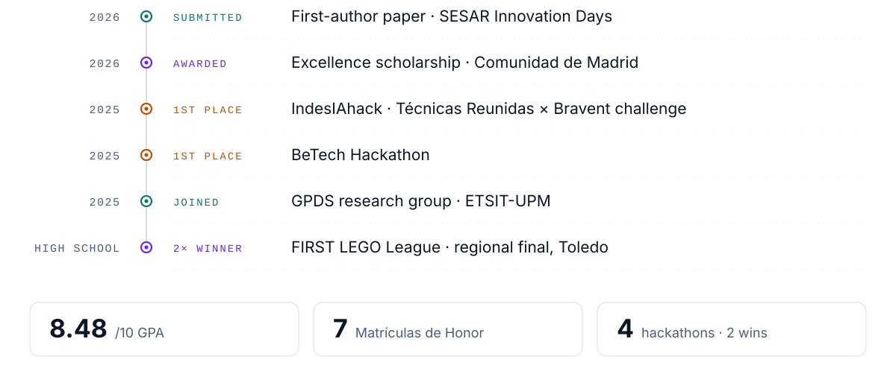
</picture>

<picture>
  <source media="(prefers-color-scheme: dark)" srcset="assets/dark/sec-stack.svg">
  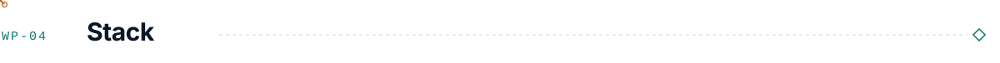
</picture>

<picture>
  <source media="(prefers-color-scheme: dark)" srcset="assets/dark/stack.svg">
  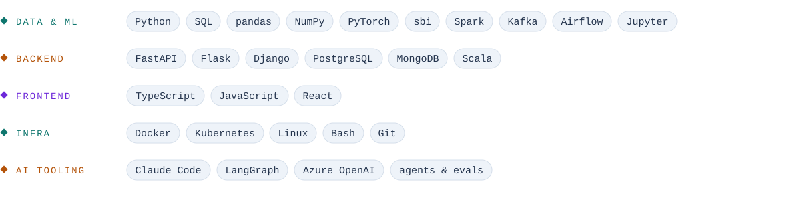
</picture>

<picture>
  <source media="(prefers-color-scheme: dark)" srcset="assets/dark/footer.svg">
  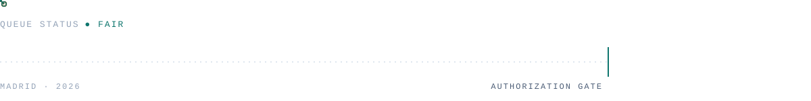
</picture>

<!-- SVGs generated by build.py — edit there, then run `python3 build.py` -->
